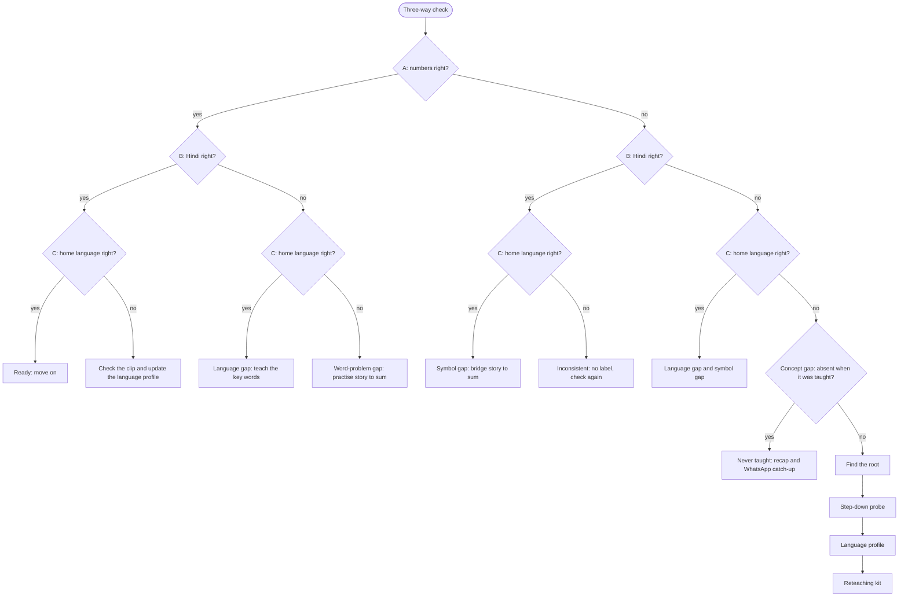

# Triveni: Problem, Solution and How It Works

## Summary

Triveni is a phone-based tool that tells a Grade 1 to 3 teacher why a child got a maths question wrong: because the child has not understood the concept, or because the child has not understood the language the question was asked in. It then tells her what to do about it the next day, and helps her reteach in a language the child understands.

It is our entry for the AI for Foundational Learning Hackathon (Hack2skill, 2026), under Challenge 1: Classroom Complexity. The main focus is sub-challenge 1A (the child's home language differs from the classroom language), extended to 1C (learning gaps caused by absence).

The name comes from the Triveni Sangam, where three rivers meet. Every question in our classroom check is asked three ways, and the pattern of answers across them shows what the child actually needs.

## The problem

In many government primary schools, children are taught in a language they do not speak at home, and a wrong answer gives the teacher no clue about its cause. In Odisha alone, about 7.48 lakh tribal children in Classes 1 to 3 meet a classroom language that is not their mother tongue (OPEPA figure, cited by IDF, 2015). Bhili, the largest tribal language in India, has about 1.04 crore speakers (Census 2011), most of whom go to Hindi-, Gujarati- or Marathi-medium schools. Worldwide, UNESCO estimates that 40% of people do not have access to education in a language they speak or understand.

### Language gap or concept gap?

Take a Grade 2 child who gets "Ravi had 15 mangoes and gave away 6. How many are left?" wrong. There are two very different explanations:

- The child cannot subtract. This is a **concept gap**, and the maths needs reteaching.
- The child can subtract but did not understand the Hindi words "gave away" or "left". This is a **language gap**, and a few words need teaching.

The two look identical on paper. So the teacher usually applies one remedy to both: she reteaches the maths to a child who needed words, or repeats the same words to a child who needed the concept. Either way, time is spent and the child does not move forward. The organisers' key messages for 1A describe exactly this: teachers cannot tell whether a child is struggling with the concept or the language, lose time translating and repeating, and have little room to slow down because the syllabus keeps moving.

### Gaps from absence

Frequent absence adds a second layer (sub-challenge 1C). Nobody keeps track of which child missed which lesson. When children return, the teacher has to decide whether to move on or repeat a topic for the whole class, without knowing who actually needs help. Even if she knew, there is no class time to reteach each child individually.

### Who is affected

| Who | How it affects them |
| --- | --- |
| Children in Grades 1 to 3 whose home language is not the classroom language | They struggle to follow instruction and are often seen as weak in maths when the real barrier is the words. |
| Their teachers | They cannot diagnose the cause of a wrong answer, so their remedies are often the wrong ones. Many do not speak the children's home language themselves. |
| Children who miss school | They fall behind on specific concepts, and later lessons that build on those concepts fail too. |

### What exists today

Triveni builds on existing work rather than replacing it. Pratham's Teaching at the Right Level (TaRL) and the ASER assessment group children by the level they can do; Triveni adds *why* a child is at that level. Odisha's multilingual education programme has produced primers and word lists in tribal languages since 2006, which are a natural source for our key words. NIPUN Bharat sets the foundational learning outcomes for Grades 1 to 3, and our concept map follows them.

## Constraints we design around

The organisers set four conditions that any realistic solution must meet, and each one shaped a design decision.

| Constraint | What it rules out | How Triveni responds |
| --- | --- | --- |
| The teacher has a mobile phone, but the internet connection comes and goes | Anything that needs a live connection during class | Offline-first: everything is captured on the phone and processed whenever a signal returns |
| Children have no devices in school, and there is no budget for smart boards | Child-facing apps used in class | Children answer on slates or in notebooks; audio plays from the teacher's phone; home follow-up goes to a parent's phone |
| Teachers cannot spend extra time designing tests, giving repeated assessments or entering data | Long assessments and manual data entry | All data comes from things she already does: taking attendance (a few taps), checking slates, a ten-second voice note |
| Teachers are wary of tools that seem to monitor their performance | Dashboards of individual teacher scores | Her class data and her own progress are never shared with supervisors |

A fifth constraint comes from the problem itself: many tribal home languages have no script of their own and almost no AI speech support. So Triveni never asks anyone to read in the home language. All audio, including check questions and Bhili, is generated from text with AI speech: Bulbul for Hindi, and AI4Bharat's Bhili model for Bhili, with the Bhili text checked by a local speaker.

## What Triveni aims for

The goal is that every child who is falling behind gets help that matches the actual cause of the gap, at their real level, in a language they understand, without adding real work to the teacher's day.

In concrete terms, Triveni aims to:

1. **Diagnose the cause, not just the error.** For each child, tell apart a concept gap, a language gap, a word-problem gap and a symbol gap.
2. **Find where the gap started.** Separate a child who was never taught a concept (because they were absent) from one who was taught it and did not learn it, since the two need different responses.
3. **Restart at the right point and in the right form.** Find the last skill the child can do, and whether they need real objects, pictures or numbers.
4. **Reteach in a language the child understands.** Use the home language as a bridge to the school language, not as a replacement for it. This follows NEP 2020, which recommends the home language as the medium of instruction wherever possible, at least until Grade 5.
5. **Bring the teacher closer to the children's language.** Help her learn the key words of each lesson in the home language, so over time she relies less on recordings.
6. **Stay within a few minutes a day.** About one minute daily, plus a weekly check of fifteen to twenty minutes. Small-group work happens inside the normal maths period.

## How Triveni solves the problem

Triveni works in four steps: a short check finds each child's type of gap, the system traces concept gaps to their root, a language profile picks the language for reteaching, and a ready kit helps the teacher reteach. Alongside this, the teacher learns the children's language, and local speakers build the audio library.

The concept-gap path is the longest for children who were present when the concept was taught: it goes through finding the root, the probe and the language profile before reteaching. Children who missed the lesson simply get it again.

### Step 1: The three-way check

Once a week, on a fixed day such as Friday, the class answers questions on the concepts taught since the last check, as recorded in the teacher's daily voice notes. A check covers at most two concepts, so it has at most six questions. If more were taught that week, Triveni picks the ones that later lessons depend on most, and the rest wait for the next check. Each question is the same kind of maths asked three ways:

| Version | What it is | Example |
| --- | --- | --- |
| A: Numbers only | No language at all, written on the board | 14 − 5 = ? |
| B: School language | A word problem played as audio from the teacher's phone | "Ravi had 15 mangoes and gave away 6. How many are left?" in Hindi |
| C: Home language | The same word problem, translated, with new numbers, played as audio | "Ravi had 13 mangoes and gave away 7. How many are left?" in Bhili, generated with AI speech |

Four design choices keep the comparison fair:

- **Different numbers, same difficulty.** Each version uses its own numbers (14 − 5, 15 − 6, 13 − 7), all of the same kind (here, subtraction within 20 that crosses a ten). A child who has just solved A cannot copy that answer into B or C.
- **C is a translation of B.** The story, the people and the verbs stay the same; only the numbers change. Otherwise a child could do better on C simply because it was an easier story. The speaker says the numbers the way local children count, which for many Bhili speakers means Hindi number words above ten.
- **Both word problems are played from the phone.** B and C both come from AI speech, so neither depends on the teacher's reading. If the teacher read B aloud and C came from the phone, a difference in answers could come from the voice rather than the language. B (Bulbul) and C (the Bhili model) are still different voices, which is a known limit.
- **The order rotates.** The version that comes first changes on each check day, so no version always benefits from coming last. Each box symbol always belongs to one version (the circle is always A), and the app tells the class which box to fill next.

Version A stays in numbers and symbols only. Pictures and real objects belong to the step-down probe (Step 2), where moving between forms is the point.

The whole class answers at the same time, so the check costs about ten minutes of class for one concept, or fifteen for two, not one minute per child. Children copy a simple template from the blackboard: their roll number and, for each concept, a row of three boxes marked with a circle, triangle and square (two rows when the check covers two concepts), since some children cannot read letters yet. They write only numbers. The teacher then photographs the slates or notebooks, five to eight at a time along a row, which takes about three minutes for 40 children. Once there is a signal, Triveni reads the handwriting and shows her a short review screen: any answer it could not read with confidence, and any roll number that is missing or appears twice. She fixes these with a tap, so no child's answers are silently given to someone else. With no signal, the photos wait on the phone, and the review screen appears once they have been read.

Early in Grade 1, children cannot yet copy the template or write numbers reliably. Until they can, the teacher runs the check orally with small groups and taps right or wrong for each child.

#### Reading the answer pattern

Each version is either right or wrong, so there are eight possible patterns. Each one leads somewhere:

| A | B | C | Meaning | What the teacher gets |
| --- | --- | --- | --- | --- |
| right | right | right | Ready | Move on |
| wrong | wrong | wrong | Concept gap | The likely root and a restart point (Step 2) |
| right | wrong | right | Language gap | The school-language words to teach first |
| right | wrong | wrong | Word-problem gap | Practice turning a story into a sum |
| wrong | right | right | Symbol gap: understands the idea in a story but not "14 − 5 = ?" | Solve a story, then write the sum that matches it |
| right | right | wrong | The home-language clip failed while Hindi worked: the child may be stronger in Hindi than assumed, or the clip or dialect was unclear | The language profile is updated; a clip that many children fail is flagged |
| wrong | wrong | right | Hearing the story in the home language made it solvable: a language gap and a symbol gap together | The language-gap words, then story-to-sum practice |
| wrong | right | wrong | Inconsistent, most likely a guess or a copied answer | No label; the next check decides |

If a child's home language is Hindi, C is the same as B, so only A and B are used. For these children, A right and B wrong means a word-problem gap, never a language gap.

#### Confirming a pattern quickly

A child is only placed in a group after the same pattern appears twice, so one bad day does not label anyone. Waiting for the next weekly check would delay help by a week, so the second look happens the next day, in group time, and only for the children who need it:

- **All three wrong:** the step-down probe (Step 2) serves as the second check.
- **Any other pattern except "ready":** a quick re-check. The five to eight children with an unconfirmed pattern answer a fresh A, B and C on their slates, and the teacher taps right or wrong for each child on her phone. With no photos to take, this takes two or three minutes. If the pattern repeats, the child joins a group.

Language evidence also builds up across weekly checks (Step 3), so a language gap seen in two different weeks is confirmed without a re-check.

One known limit: everyone hears the same B and C, so a child can copy a neighbour's answer and look ready. The inconsistent pattern catches some of this, and a child who keeps struggling shows up again in the next week's check.

#### Reading the wrong answer itself

The number a child writes when they are wrong usually shows *how* they went wrong. When a question is written, Claude lists its likely wrong answers and what each one means, and a person reviews the list. It is stored with the question. For 15 − 6:

| Answer | What it means | Points to |
| --- | --- | --- |
| 21 | Added instead of subtracted | The direction word ("gave away", "bache") |
| 11 | Took the smaller digit from the larger one (5 from 6), a well-known borrowing mistake | Concept: borrowing |
| 8 or 10 | Counted one too few or one too many | Concept: counting |
| 15 or 6 | Copied a number from the question | Not engaged: no data |
| blank | Did not attempt | No data |

Marking is a plain lookup in this list, so it works offline. Any wrong answer not on the list is saved, and Claude suggests a cause once a signal returns. The results feed the rest of the system: an addition answer to a take-away story in B is evidence that the child missed the direction word; a borrowing mistake in A sends the probe straight to borrowing; and a copied number or blank counts as no data, not as a wrong answer.

#### Finding the words that caused the trouble

Every word problem in the question bank is tagged with its key words, such as "bache" (left over), "kam karna" (reduce), "kul" (in all), "zyada" (more) and "milkar" (together). The key words change from one check to the next. Each time a child gets a B question wrong (especially with an addition-for-subtraction kind of mistake) while getting A and C right, the tagged words in that question gain evidence against them. Over a few checks, this gives each child, and the class, an evidence-based list of the Hindi words that block them. The teacher teaches those words before the next lesson.

#### Classes with more than one home language

Every child's home language is recorded when they join, so C is personal to each child. In class, the phone plays C once for each home language present, and each clip starts with a picture for that language group (for example, a tree for Bhili and a river for Gondi). Children fill in the C box only when their own clip plays. Most classes have one or two home languages, so this adds a minute or two. Children whose home language is Hindi skip C, since B already covers it. If no recording exists yet for a child's language, C goes to the parent's phone as a home task, and it counts for less because an adult may help.

This design borrows a method from research. A study from Ashoka University on language and learning in mixed communities compared children's results on language-based tasks with a language-free task (mazes) to measure the effect of language distance. Version A plays the role of the maze, inside normal classwork.

### Step 2: Finding the root of a concept gap

A child who fails all three versions needs the maths retaught, but the real gap may be much earlier. Triveni uses two sources of evidence to find it.

**Attendance shows whether the child was present when a concept was taught.** At the end of each day, the teacher opens a class list where everyone is marked present and taps the children who were absent, which takes about fifteen seconds. She then records a ten-second voice note on what she taught, for example "borrowing in subtraction, page 34". Triveni matches the textbook page number to a concept first, and only uses the spoken words when no page is given.

**The check shows whether the child can do it now.** Results are stored as a running record of which concepts each child has shown they can do.

Together, these split failure into two cases that need opposite responses:

|  | Passed the check | Failed the check |
| --- | --- | --- |
| Present when it was taught | Learned it: move on | **Taught but not learned:** reteach with a different method, form or language, since repeating the same lesson will likely fail again |
| Absent when it was taught | Picked it up elsewhere: move on | **Never taught:** give the normal lesson, which may be all they need |

Children who were never taught get the normal lesson as a recap in group time, and a catch-up on WhatsApp: a home-language voice note to the parent that walks through the lesson with a household activity. They are checked on the concept at the next weekly check.

A child who is absent **on check day** is not marked wrong. If they also missed the lesson, they are treated as never taught, as above. If they were present for the lesson, their result is simply "not checked yet", and they are included in the next weekly check.

Triveni also keeps a **concept map**: a chart of which concepts must be learned before which others, built from NCERT and state textbooks and matched to the NIPUN Bharat learning outcomes. When a child fails, the system checks the map against their attendance and the kind of wrong answer they gave. For example, Meena fails two-digit subtraction; the map shows it depends on borrowing; attendance shows she was absent both days borrowing was taught; and she wrote 11 for 15 − 6, the classic borrowing mistake. So the likely root is borrowing.

Attendance and wrong answers only suggest where to look. A five-minute **step-down probe**, run in group time the day after the check, confirms it. This is an oral script the teacher runs with the small group that failed everything and was present when the concept was taught. It also serves as the second check: a child who solves the problem in numbers straight away had a bad day and goes back to the class, with no label. For the others, it moves to easier skills, and to more concrete forms, until each child succeeds:

| Form | What the child works with | Example for 15 − 6 |
| --- | --- | --- |
| Concrete | Real objects | 15 stones; take 6 away and count what is left |
| Pictorial | Drawings | 15 drawn mangoes, 6 crossed out |
| Abstract | Numbers and symbols | 15 − 6 = ? |

The probe starts at the suspected root, so it needs fewer steps. The teacher logs results with a tap or a voice note. The output is a restart point and a form for each child, for example "start with take-away using real objects, then move to drawings".

### Step 3: Choosing the language for reteaching

A child who failed all three versions also got the home-language version wrong, so the check alone cannot say which language to reteach in. Each child therefore has a **language profile**.

It starts with a one-time, five-minute listening check for the whole class. Four numbered pictures go on the board, and the phone plays instructions in each language, such as "write the number of the goat". Children write a number, and the teacher photographs the slates or notebooks. No reading or writing of words is needed, so it measures only spoken understanding. The teacher can add what she already knows ("speaks Bhili at home").

After that, every three-way check updates the profile, whatever the topic. This matters because the two kinds of gap behave differently over time:

- **A language gap belongs to the child.** If Ravi does not follow Hindi, that is as true in next week's addition check as in this week's subtraction check. So language evidence adds up across every check. A subtraction check and an addition check that both show a language-gap pattern are enough, even though each topic was checked only once.
- **A concept gap belongs to the child and one topic.** Meena failing subtraction says nothing about whether she can add. So concept evidence adds up only for that concept and the concepts it depends on in the map.

| If the child understands | Reteach in |
| --- | --- |
| the home language far better | the home language first, then the school-language words for the same idea |
| both reasonably well | the school language, with home-language key words mixed in |
| the school language well | the school language |

Teaching the concept first in the child's strongest language, and then bridging to the school words, keeps the child from being left behind in the language used for textbooks and exams.

#### What Triveni remembers about each child

Triveni keeps a running record for each child, and the morning brief's groups are worked out from it each day. No fixed label is stored:

| Part of the record | What it holds | Updated by |
| --- | --- | --- |
| Home language | The language spoken at home | Enrolment, the teacher |
| Language profile | How well the child understands the school language and the home language | The listening check and every three-way check |
| Word evidence | For each key word, how often the child met it and how often they stumbled on it | Every word problem |
| Concept status | For each concept: not taught (absent), taught but not learned, or learned, plus the kinds of mistakes seen | Attendance, checks and probes |

### Step 4: The reteaching kit

Many teachers do not speak the children's home language. Triveni splits the work: the teacher handles the demonstration and the classroom, while recorded audio and a few key words carry the language. For each gap, she gets:

- **Paired demonstration audio.** A step-by-step script where each step says what she does and what the audio says. For example, she lays out 15 stones while the audio asks, in Bhili, "How many stones are here? Let's count together." She plays a step, acts it out, pauses, and moves on.
- **A key-word card.** The 8 to 10 most important words for the topic ("take away", "how many are left", "count"), written the way they sound in her script, with audio for pronunciation. She mixes them into her explanation, a recognised practice in multilingual classrooms known as translanguaging.
- **A bilingual classmate helper.** The language profiles show which children understand both languages well. One of them sits with the group to repeat instructions in the home language.
- **A parent voice note.** A home-language voice note goes to the parent's phone with a five-minute activity using household objects, such as moving grains of rice and counting what is left.

### The teacher meets the children midway

The child moves toward the school language; Triveni also moves the teacher toward the home language.

- **Tomorrow's words, the evening before.** A five-minute audio drill teaches her the key words for the next day's lesson, from the same recordings the children hear. Everyday classroom phrases ("sit down", "listen", "well done", "try again") come first.
- **Spaced reviews.** Each word comes back after one day, then three days, then a week, just before she would forget it. This method is called spaced repetition.
- **Support that fades.** As she learns words, the reteaching scripts hand those lines from the audio to her. Over the year, her voice gradually replaces the recordings.
- **Pronunciation checked by people.** She compares her attempt with the local speaker's recording, or sends a voice note to that speaker.

The realistic goal is a few hundred words a year: about 10 words per topic × 2 topics a week × 30 weeks ≈ 600 words met, of which she will keep fewer. That will not make her fluent, but it is enough to give instructions, praise children and explain core ideas partly in their language. Her progress is private and optional.

### Generated home-language audio, checked by people

AI speech now exists for Bhili (AI4Bharat's bhili-tts), written in Devanagari. So home-language audio is generated from text, not recorded:

1. The AI writes the script in the school language.
2. A translation model turns it into Bhili, and a local speaker (the teacher, the anganwadi worker, a parent or an older student) corrects the text.
3. The Bhili model speaks it on demand, and the audio is cached for reuse across classes.
4. The teacher can flag any clip the children did not follow.

Other home languages, such as Gondi and Kurukh, need their own speech models before they can be added.

## How it runs

Triveni uses two channels: an app for everything that happens in class, and WhatsApp for everyone outside it.

| Who | Channel | Why |
| --- | --- | --- |
| Teacher, in class | An installable web app (PWA) that works offline | The check has to play the B and C clips in order with no signal, and she needs the attendance list, the handwriting review screen and a cached morning brief. A web app installs on any Android phone without the Play Store and keeps working from data saved on the phone. |
| Teacher, outside class (optional) | WhatsApp | The morning brief also arrives as a WhatsApp message, so she can read it anywhere. |
| Parents | WhatsApp | The home-language voice note with an activity, an optional reply (a thumbs-up or a voice note of the child), and the home-language check for children whose language has no class recording yet. The teacher signs parents up with a click-to-chat QR code. |
| Community recorders | A WhatsApp bot | The bot sends a script line, the speaker replies with a voice note, and a second speaker approves or rejects it with a button. |

The grouping rules run on the phone itself, so the morning brief is always ready, built from a fixed template. When there is a signal, Claude rewrites it in plainer words. Reading handwriting from photos, turning voice notes into text and rewording the brief are the only steps that wait for a signal.

### What the AI does, and what it does not

The AI reads, writes and, in Hindi only, speaks; fixed rules make the decisions.

| | Role |
| --- | --- |
| **AI reads** | Children's handwritten answers and wrong answers that are not in a question's list (Claude); the teacher's voice notes, turned into text (Sarvam Saaras) |
| **AI writes** | Matched questions with controlled key words, the list of likely wrong answers for each question, reteaching scripts, key-word cards and the text of the morning brief (Claude) |
| **AI speaks** | Hindi audio, including the B check questions (Sarvam Bulbul), and all Bhili audio, including the C check questions (AI4Bharat bhili-tts) |
| **Rules decide** | Grouping children by answer pattern, tracing the concept map, the language profile and the spaced-review schedule |

This keeps every decision explainable to the teacher, and testable.

## A week in the classroom

Sunita (an illustrative persona) teaches Grade 2 in a Hindi-medium government school in a Bhili-speaking area. She has 42 children, one Android phone with patchy data, and knows only a few Bhili words. Here is what Triveni asks of her.

| When | Time | What she does |
| --- | --- | --- |
| End of each day | about 1 min | Taps the absent children and records "taught borrowing in subtraction, page 34" |
| Each morning | about 1 min | Reads the brief: who is back, what they missed, whether to recap or move on, today's groups |
| Check day, once a week | about 15 to 20 min | Runs the three-way check on the week's concepts (10 to 15 min), photographs the slates row by row (3 min) and fixes any flagged answers (1 min); groups are ready by the next morning |
| Group time, inside the maths period | 5 to 15 min | Runs quick re-checks and the probe, teaches the blocking words, plays reteaching audio, pairs buddies, while the rest of the class practises from the textbook |
| After school | nothing | Parents receive a home-language voice note with a short activity, or a catch-up lesson for a concept their child missed |
| Evening, optional | about 5 min | Practises tomorrow's 8 to 10 Bhili words and some classroom phrases |

Group time is not extra time. While Sunita works with one small group, the rest of the class does practice from the textbook, and some of the children who are ready sit with classmates as buddies.

A typical morning brief reads:

- Ravi and Meena are back. Both missed borrowing on Thursday and Friday.
- 9 of 42 missed it, and it is needed next week. Recap with them in group time; catch-up voice notes go to their parents tonight.
- Language group (6), including Ravi: teach "bache" and "kam karna" first. Audio is downloaded.
- Concept group (5): Arjun and two others wrote 11 for 15 − 6, a borrowing mistake, not a language one. They were present when it was taught, so the probe starts at borrowing.
- Quick re-check (4): patterns seen once on Friday. Re-check in group time.

Before Triveni, when Ravi got a subtraction question wrong, Sunita had to guess whether he did not understand subtraction or did not understand Hindi, and whether to repeat the topic for everyone. With Triveni, the brief answers both before the first period, and the class keeps moving while the few children who need help get it.

## Full hackathon build

If time runs short, we fall back to the bare minimum MVP below. The full build covers the core loop for one language pair, **Hindi and Bhili**, and one chain of concepts: numbers to 20, subtraction within 20, borrowing, and two-digit subtraction.

**Built:**
- The three-way check with matched questions, played from the teacher's app
- Photographs of slates, handwriting reading and the review screen
- Wrong-answer lookup and all eight answer patterns
- Quick re-checks by tap, and the probe as the second check
- Each child's running record and the concept map for the chain above
- Tap-to-mark attendance, and voice notes turned into text with Sarvam Saaras and matched by page number
- The morning brief
- A reteaching kit for one gap
- Parent voice notes on WhatsApp, including catch-up lessons for missed concepts
- Hindi audio from Sarvam Bulbul: how key words sound, the brief read aloud and voice notes to Hindi-speaking parents

**Shown as designs:** the teacher's language learning, the community audio library.

### How we test it

We build a simulated class of made-up children, each with a hidden cause planted in advance (a language gap, a concept gap with a known root, absences on given days, the occasional careless mistake). We run their answers through Triveni over several checks and measure how often it finds the true cause, and how many checks it takes. In a real pilot, the same comparison would be made against a one-on-one oral assessment by an experienced teacher.

## Bare minimum MVP (fallback)

If time runs short, this is the smallest version that still shows the core idea: one check, asked three ways, that separates a language gap from a concept gap, with attendance explaining the concept gaps.

### Scope

- **One language pair:** Hindi (school language) and Bhili (home language).
- **One short chain of concepts:** numbers to 20, subtraction within 20, borrowing.
- **One user:** the teacher, using a web app on her phone. The demo assumes a signal; offline support comes later.
- **Audio:** generated, not recorded. The Hindi B questions come from Bulbul; the Bhili C questions are machine-translated and spoken live by bhili-tts. B and C being different voices is a known limit we name in the demo.

### The flow

1. **Class setup (once).** The teacher enters roll numbers and each child's home language.
2. **Daily log (about 30 seconds).** She taps the absent children and picks the day's concept from a dropdown, instead of recording a voice note.
3. **Check day.** The app shows A (14 − 5 = ?) for the board, then plays B in Hindi and C in Bhili, each with its own numbers. Children write three numbers on their slates. She photographs the slates, Claude reads the numbers, and she corrects any it flags.
4. **Results.** Each child lands in one of five groups:

| A | B | C | Group | What the teacher gets |
| --- | --- | --- | --- | --- |
| right | right | right | Ready | Move on |
| right | wrong | right | Language gap | A key-word card: the Hindi words in the question, with Bhili audio |
| right | wrong | wrong | Word-problem gap | Three practice stories |
| wrong | wrong | wrong | Concept gap | **Never taught** (absent that day): recap the lesson. **Taught but not learned** (present): play the Bhili reteaching clip and use real objects. |
| any other | | | Unclear | Check again next time |

The whole product is: log attendance, run the check, photograph the slates, see the groups and what to do next.

Without the "same pattern twice" rule (stretch goal 3), a single check places a child in a group, so one bad day can mislabel a child. We say so in the demo.

### Where AI is used

- **Reading:** Claude reads the handwritten numbers from the photos.
- **Writing:** Claude writes the short brief for the teacher, and, ahead of time, the matched questions and key-word cards, which the team reviews.
- **Deciding:** grouping is plain rules, with no AI involved.

### Stretch goals, in order

1. Wrong-answer lookup (21 means the child added; 11 means a borrowing mistake).
2. A WhatsApp voice note to the parent.
3. The rule that a pattern must appear twice before a child is placed in a group.

### Left out of the MVP

These stay as the full vision described above: the symbol gap and the other mixed patterns, the step-down probe, the language profile and listening check, word-by-word evidence, quick re-checks, classes with more than one home language, rotating the order of versions, voice notes, offline-first design, the teacher's language learning, the community recording bot and WhatsApp catch-up lessons.

### Demo (about 3 minutes)

1. Load a simulated class of 20 children with two weeks of attendance already filled in.
2. Run one check live: play the clips and photograph three or four real slates.
3. Show the results. Ravi lands in the language-gap group with a Hindi word card; Meena lands in "never taught", because she was absent the day borrowing was taught.
4. Close with one slide on the full vision.

